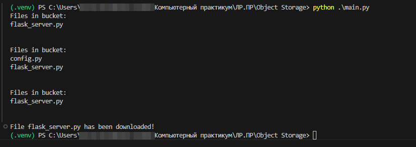

+++
title = 'Практическая работа №9 - Object Storage'
date = '2025-06-06'
draft = false
weight = 9
+++

### Отчёт
В yandex.cloud было создано стандартное хранилище.
Был получен ключ для работы с ним.
Для работы с хранилищем был создан "пользователь" с полным доступом.

Ключи для доступа к хранилищу были помещены в 
* C:/Users/< user >/.aws/credentials
* C:/Users/< user >/.aws/config

### Описание работы программы
Шаги работы программы:
1. загружает файл config.py в хранилище.
2. удаляет файл config.py из хранилища.
3. скачивает файл flask_server.py из хранилища.
* После каждого действия программа выводит список файлов в хранилище.
* Все операции выполняются с помощью библиотеки boto3.
Демонстрация работы программы:

